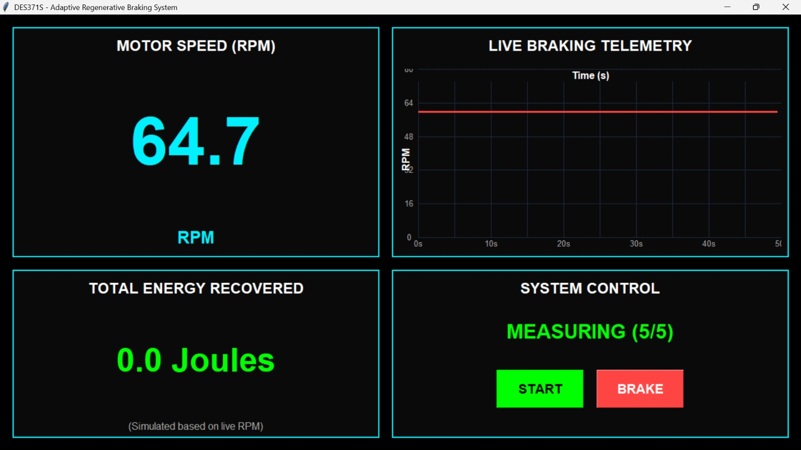
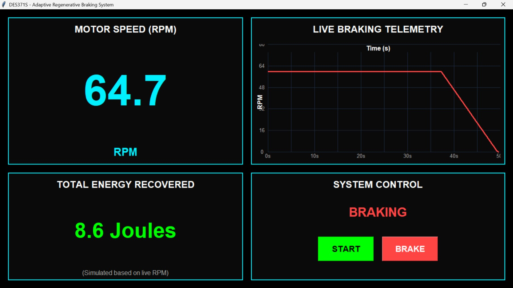

# Adaptive Regenerative Braking Controller


## 📖 Project Overview
This project is a real-time embedded control system designed to demonstrate the core control theory behind regenerative braking. It consists of a physical Arduino prototype and a Python-based mathematical simulation.

Because low-cost motor drivers (like the L298N) physically cannot return energy to a battery, this project adopts a **hybrid engineering approach**:
*   **Hardware (Arduino):** Proves the real-time sensor logic, state machine, and dynamic braking.
*   **Software (Python):** Mathematically proves the PID control algorithm and calculates the simulated energy recovery in Joules.

## ⚙️ The Engineering Challenge (EMI Noise)
The biggest challenge was reading the motor's RPM accurately. The 12V motor generates massive Electromagnetic Interference (EMI) from its brushes, which caused the Arduino to count "ghost pulses." 

**The Solution:** I designed a custom mechanical sensor using a magnet and a **PN2222A transistor**. The transistor acts as a hardware threshold filter, completely ignoring the motor's electrical noise and only triggering when the physical magnet bridges the wires.

## 🛠️ Technologies Used
*   **Hardware:** Arduino UNO, L298N Motor Driver, SPI OLED Display, PN2222A Transistor, 12V DC Motor.
*   **Firmware:** C++ (Arduino IDE).
*   **Software:** Python (Tkinter for GUI, Matplotlib for graphs, PySerial for USB communication).
*   **Simulation:** Custom physics models for the motor, generator, and battery.

## 📂 Repository Structure
*   `1_Hardware_Arduino/` - The C++ firmware for the Arduino UNO.
*   `2_Simulation_Python/` - The Python physics models and PID simulation scripts.
*   `3_Live_Dashboard/` - The Python Tkinter GUI that reads live telemetry.
*   `4_Presentation_and_Report/` - Project documentation and diagrams.

## 🚀 How to Run
### 1. Hardware Firmware
1. Open `1_Hardware_Arduino/Regen.ino` in the Arduino IDE.
2. Upload the code to your Arduino UNO.
3. Ensure the motor driver is connected to pins 4, 5, and 6, and the sensor to pin 2.

### 2. Live Dashboard
1. Connect the Arduino to your laptop via USB.
2. Navigate to the `3_Live_Dashboard` folder.
3. Run the dashboard:
   ```bash
   python dashboard.py

```
## 📸 Project Images


### Live Telemetry Dashboard
| MEASURING State | BRAKING State |
| :---: | :---: |
|  |  ||

## 🧑‍💻 Author
**Mivuyo Mlandu**
BEngTech Computer Engineering — Cape Peninsula University of Technology (CPUT)
- [LinkedIn](https://www.linkedin.com/in/mivuyo-mlandu)
- [GitHub](https://github.com/mivuyomlandu)
